# Yosan Architecture & Bug Audit Report: Login Flow Mismatches and Systemic Defects

> **Audit Date:** November 2026  
> **Target Project:** Yosan Finance App (`/home/pain/Downloads/Yosan`)  
> **Status:** Strictly Read-Only Architectural & Functional Audit (No Code Changes Applied)

---

## 1. Executive Summary

A comprehensive architectural and functional audit of the **Yosan** Android codebase reveals several systemic defects in authentication, session lifecycle, multi-tenant database partitioning, and background synchronization. 

The most critical finding is a **complete disconnection between the frontend authentication UI and the backend authentication service**:
1. **Google Sign-In is completely bypassed:** While a complete, secure OAuth 2.0 Credential Manager implementation exists in [AuthViewModel.kt](file:///home/pain/Downloads/Yosan/app/src/main/java/com/example/features/auth/AuthViewModel.kt#L265-L460) (`signInWithGoogle`), it has **zero callers** across the entire project. Instead, the UI calls a helper that fabricates synthetic, fake tokens locally (`yosan_tok_...` and `yosan_ref_...`).
2. **Inevitable Session Eviction (HTTP 401 Cascade):** When synthetic tokens expire, the app sends them to `/api/auth/refresh`. The server rejects them with `HTTP 401 Unauthorized`, causing the app to wipe the user's session and forcibly kick them back to login.
3. **Email OTP Users Booted on Every App Restart:** The session resolver in [AuthViewModel.kt](file:///home/pain/Downloads/Yosan/app/src/main/java/com/example/features/auth/AuthViewModel.kt#L70-L75) requires `googleSub` to be non-blank. Because Email OTP users do not have a `googleSub`, their sessions are invalidated on every cold start.
4. **Guest Database Contamination During Onboarding:** During Google Sign-In on the onboarding screen, profile updates and account checks are executed against the `guest` database instance before `MainActivity` has switched to the authenticated user's partition.
5. **Stale Database Reference in SyncManager:** `SyncManager` retains the initial `guest` database reference for its entire lifecycle, causing background Drive sync to back up empty guest data rather than the authenticated user's finances.

---

## 2. Authentication Flow Breakdown: Expected vs. Actual

```mermaid
flowchart TD
    subgraph Actual Broken Flow
        A1["User Clicks Google Sign In"] --> A2["googleSignInLauncher Launches Legacy Intent<br/>(No ID Token Requested)"]
        A2 --> A3["OnboardingScreen calls signInWithGoogleAccount()"]
        A3 --> A4["Fabricates Fake Local Tokens:<br/>'yosan_tok_...' & 'yosan_ref_...'"]
        A4 --> A5["Zero Communication with Backend /api/auth/google"]
        A5 --> A6["Token Expires or ApiClient calls /api/auth/refresh"]
        A6 --> A7["Backend Returns HTTP 401 Unauthorized"]
        A7 --> A8["clearSession() Triggered -> User Booted to Login"]
    end

    subgraph Intended Secure Flow
        B1["User Clicks Google Sign In"] --> B2["CredentialManager / signInWithGoogle()"]
        B2 --> B3["Obtains Valid Google JWT ID Token"]
        B3 --> B4["POST /api/auth/google with idToken"]
        B4 --> B5["Backend Issues Signed JWT Access & Refresh Tokens"]
        B5 --> B6["SecureTokenManager Saves Verified Tokens"]
        B6 --> B7["Session Auto-Refreshes Cleanly on Expiry"]
    end
```



---

## 3. Detailed Audit Findings

### 3.1. Core Login Flow Mismatches

#### Defect 1: Dead Code vs. Synthetic Tokens in Google Sign-In
* **Primary Files:** 
  * [AuthViewModel.kt](file:///home/pain/Downloads/Yosan/app/src/main/java/com/example/features/auth/AuthViewModel.kt#L265-L460) (lines 265–460)
  * [OnboardingScreen.kt](file:///home/pain/Downloads/Yosan/app/src/main/java/com/example/features/auth/OnboardingScreen.kt#L126-L170) (lines 126–170)
  * [GoogleAuthManager.kt](file:///home/pain/Downloads/Yosan/app/src/main/java/com/example/features/auth/GoogleAuthManager.kt#L219-L229) (lines 219–229)
* **Mechanics:**
  `AuthViewModel.kt` defines `fun signInWithGoogle(context, ...)`, which integrates Android's modern `CredentialManager`, extracts a real Google ID token, calls the backend endpoint `/api/auth/google`, and handles cloud account restoration. **This method is never called anywhere in the codebase.**
  Instead, [OnboardingScreen.kt](file:///home/pain/Downloads/Yosan/app/src/main/java/com/example/features/auth/OnboardingScreen.kt#L149) invokes `authViewModel.signInWithGoogleAccount(cleanEmail, ...)`.
  In `GoogleAuthManager.getGoogleSignInIntent()`, `requestIdToken()` is omitted:
  ```kotlin
  val gso = GoogleSignInOptions.Builder(GoogleSignInOptions.DEFAULT_SIGN_IN)
      .requestEmail()
      .requestProfile()
      .build()
  ```
  Consequently, `idToken` is null. `signInWithGoogleAccount()` manufactures dummy strings:
  ```kotlin
  val dynamicAccessToken = "yosan_tok_${AppDatabase.sanitizeUserKey(cleanEmail)}_${System.currentTimeMillis()}_${UUID.randomUUID()}"
  val dynamicRefreshToken = "yosan_ref_${AppDatabase.sanitizeUserKey(cleanEmail)}_${System.currentTimeMillis()}_${UUID.randomUUID()}"
  ```
* **Impact:** The backend server never validates the user's Google credentials, creating a disconnected offline-only session disguised as an authenticated session.

---

#### Defect 2: Session Eviction on Token Expiration (HTTP 401 Wipeout)
* **Primary Files:**
  * [AuthViewModel.kt](file:///home/pain/Downloads/Yosan/app/src/main/java/com/example/features/auth/AuthViewModel.kt#L200-L220) (lines 200–220)
  * [ApiClient.kt](file:///home/pain/Downloads/Yosan/app/src/main/java/com/example/data/remote/ApiClient.kt#L101-L128) (lines 101–128)
  * [ApiClient.kt](file:///home/pain/Downloads/Yosan/app/src/main/java/com/example/data/remote/ApiClient.kt#L209-L212) (lines 209–212)
* **Mechanics:**
  In `ApiClient.kt` (lines 101–104), any HTTP 401 response triggers an automatic background session refresh via `refreshAccessTokenSync(context, refreshToken)`. Similarly, [AuthViewModel.kt](file:///home/pain/Downloads/Yosan/app/src/main/java/com/example/features/auth/AuthViewModel.kt#L200) triggers `checkSession()` when `tokenManager.isSessionExpired()` is true.
  Both send `storedRefreshToken` to `POST /api/auth/refresh`.
  Because the stored refresh token is the synthetic `yosan_ref_...`, the backend rejects it with `HTTP 401 Unauthorized`.
  Both handlers treat 401 on refresh as terminal:
  ```kotlin
  // ApiClient.kt line 209
  } else if (res.code == 401 || res.code == 403) {
      tokenManager.clearSession()
      com.example.utils.AppPreferences(context).isLoggedOut = true
  }
  ```
* **Impact:** Every user who logs in with Google is abruptly evicted from their account once the token expiration threshold is hit.

---

#### Defect 3: Email OTP Users Permanently Evicted on Cold Start (`googleSub` Check)
* **Primary Files:**
  * [AuthViewModel.kt](file:///home/pain/Downloads/Yosan/app/src/main/java/com/example/features/auth/AuthViewModel.kt#L70-L75) (lines 70–75)
  * [AuthViewModel.kt](file:///home/pain/Downloads/Yosan/app/src/main/java/com/example/features/auth/AuthViewModel.kt#L184-L197) (lines 184–197)
  * [AuthViewModel.kt](file:///home/pain/Downloads/Yosan/app/src/main/java/com/example/features/auth/AuthViewModel.kt#L1309-L1319) (lines 1309–1319)
* **Mechanics:**
  In `verifyOtp()`, the backend returns `UserDto`. For email OTP accounts, `authRes.user.googleSub` is blank (`""`):
  ```kotlin
  tokenManager.saveUserSession(
      userId = authRes.user.id,
      googleSub = authRes.user.googleSub, // Empty string for OTP users
      email = authRes.user.email,
      ...
  )
  ```
  However, both `resolveInitialAuthState()` and `checkSession()` require `googleSub` to be present:
  ```kotlin
  // Line 71 & Line 184
  if (storedAccessToken.isNullOrBlank() || userEmail.isNullOrBlank() || googleSub.isNullOrBlank()) {
      AppDatabase.setActiveUserKey("guest")
      ...
      _authState.value = AuthState.Unauthenticated
      return@launch
  }
  ```
* **Impact:** Any user who signs up or logs in via Email OTP is instantly demoted to unauthenticated guest status upon closing and reopening the app.

---

#### Defect 4: Deep Link OAuth Callback Treats Code as ID Token
* **Primary Files:**
  * [AuthViewModel.kt](file:///home/pain/Downloads/Yosan/app/src/main/java/com/example/features/auth/AuthViewModel.kt#L829-L835) (lines 829–835)
* **Mechanics:**
  When browser OAuth redirects to `yosan://auth-callback?code=...`, `handleDeepLink(uri)` executes:
  ```kotlin
  val code = uri.getQueryParameter("code")
  ...
  val response = authApi.authenticateGoogle(GoogleAuthRequest(idToken = code))
  ```
  The endpoint expects a cryptographically signed OpenID Connect JWT `idToken`. Passing the raw PKCE/OAuth authorization code directly causes backend JWT deserialization failure.
* **Impact:** Browser-based OAuth fallback redirects fail 100% of the time.

---

#### Defect 5: Profile Linking Omission of Authentication Tokens
* **Primary Files:**
  * [AuthViewModel.kt](file:///home/pain/Downloads/Yosan/app/src/main/java/com/example/features/auth/AuthViewModel.kt#L1887-L1895) (lines 1887–1895)
* **Mechanics:**
  In `linkOfflineProfileToGoogle(claims)`:
  ```kotlin
  tokenManager.saveUserSession(
      userId = 1L,
      googleSub = claims.sub,
      email = cleanEmail,
      name = currentName,
      profilePicture = claims.picture,
      emailVerified = true
      // accessToken and refreshToken are omitted!
  )
  ```
  Because no access or refresh tokens are saved, `checkSession()` on subsequent app restarts fails at line 184 (`storedAccessToken.isNullOrBlank()`), reverting the user to an unauthenticated state.

---

### 3.2. Lifecycle, Navigation & Gatekeeper Race Conditions

#### Defect 6: Onboarding Step 1 vs Step 2 Race Condition & Guest Partition Leak
* **Primary Files:**
  * [MainActivity.kt](file:///home/pain/Downloads/Yosan/app/src/main/java/com/example/MainActivity.kt#L84-L95) (lines 84–95)
  * [MainActivity.kt](file:///home/pain/Downloads/Yosan/app/src/main/java/com/example/MainActivity.kt#L331-L342) (lines 331–342)
  * [OnboardingScreen.kt](file:///home/pain/Downloads/Yosan/app/src/main/java/com/example/features/auth/OnboardingScreen.kt#L66) (line 66)
  * [OnboardingScreen.kt](file:///home/pain/Downloads/Yosan/app/src/main/java/com/example/features/auth/OnboardingScreen.kt#L149-L168) (lines 149–168)
* **Mechanics:**
  In `MainActivity.kt`:
  ```kotlin
  val activeUserKey = if (isAuthenticated && !currentEmail.isNullOrBlank()) {
      AppDatabase.sanitizeUserKey(currentEmail)
  } else {
      "guest"
  }
  AppDatabase.setActiveUserKey(activeUserKey)
  val financeViewModel: FinanceViewModel = viewModel(key = "finance_vm_$activeUserKey")
  ```
  While the user is on the login step, `activeUserKey` is `"guest"`.
  When Google login returns in [OnboardingScreen.kt](file:///home/pain/Downloads/Yosan/app/src/main/java/com/example/features/auth/OnboardingScreen.kt#L159-L160):
  ```kotlin
  financeViewModel.updateUserProfile(userName, currencySymbol)
  val hasBankAccount = accounts.any { it.accountType != AccountType.CASH }
  ```
  1. `financeViewModel` is still the **guest** instance (`finance_vm_guest`). It writes the user's name and currency to `yosan_db_guest.db`.
  2. `accounts` reflects the guest database's accounts.
  3. `authViewModel` transitions `authState` to `Authenticated(isNewUser = true)`.
  4. `MainActivity` recomposes and flips `targetScreen` to `RootScreenState.ONBOARDING_STEP_2`.
  5. `AnimatedContent` tears down the active `OnboardingScreen` (initialStep = 1) along with any in-flight Drive backup check dialogs (`showBackupFoundDialog`), creating a new `OnboardingScreen` (initialStep = 2).
* **Impact:** In-flight dialogs are destroyed; profile preferences are written to the guest database rather than the authenticated partition.

---

#### Defect 7: Missing Android BackHandler in Onboarding
* **Primary Files:**
  * [OnboardingScreen.kt](file:///home/pain/Downloads/Yosan/app/src/main/java/com/example/features/auth/OnboardingScreen.kt)
  * [MainContainerScreen.kt](file:///home/pain/Downloads/Yosan/app/src/main/java/com/example/ui/screens/MainContainerScreen.kt#L186) (line 186)
* **Mechanics:**
  `BackHandler` is only declared inside [MainContainerScreen.kt](file:///home/pain/Downloads/Yosan/app/src/main/java/com/example/ui/screens/MainContainerScreen.kt#L186). Neither `MainActivity` nor `OnboardingScreen` registers a `BackHandler` for `ONBOARDING_LOGIN` or `ONBOARDING_STEP_2`.
* **Impact:** If a user is on Step 2 (setting up their bank account) or has opened the "Switch Account" dialog, pressing the Android system back button/gesture immediately terminates or minimizes the application instead of stepping back to Step 1 or dismissing the dialog.

---

#### Defect 8: Cold-Start UI Flicker into Onboarding Step 2 for Offline Users
* **Primary Files:**
  * [MainActivity.kt](file:///home/pain/Downloads/Yosan/app/src/main/java/com/example/MainActivity.kt#L331-L342) (lines 331–342)
* **Mechanics:**
  ```kotlin
  val hasBankAccount = userAccounts.any { it.accountType != AccountType.CASH }
  val isUserOnboardingDone = appPreferences.isOnboardingCompletedForUser(currentEmail) ||
      userProfile?.isOnboardingCompleted == true ||
      hasBankAccount
  ```
  For offline users, `currentEmail` is `""`. `appPreferences.isOnboardingCompletedForUser("")` returns false. On cold start, `userProfile` starts as `null` and `userAccounts` as `emptyList()`.
  Consequently, on the very first frame after the splash screen finishes:
  `isUserOnboardingDone` evaluates to `false`.
  `targetScreen` resolves to `RootScreenState.ONBOARDING_STEP_2`.
  A few frames later, Room emits the profile from disk, and `targetScreen` jumps to `RootScreenState.MAIN`.
* **Impact:** A noticeable, jarring visual flash of Onboarding Step 2 appears before the dashboard renders.

---

#### Defect 9: Biometric Auto-Lock Triggering on Return from System OAuth Dialogs
* **Primary Files:**
  * [MainActivity.kt](file:///home/pain/Downloads/Yosan/app/src/main/java/com/example/MainActivity.kt#L258) (lines 258–268)
  * [MainActivity.kt](file:///home/pain/Downloads/Yosan/app/src/main/java/com/example/MainActivity.kt#L280-L293) (lines 280–293)
  * [OnboardingScreen.kt](file:///home/pain/Downloads/Yosan/app/src/main/java/com/example/features/auth/OnboardingScreen.kt#L102-L128) (lines 102–128)
* **Mechanics:**
  When `googleSignInLauncher` or `driveConsentLauncher` opens an external system activity, `MainActivity` enters `ON_STOP`.
  In `MainActivity.kt`:
  ```kotlin
  Lifecycle.Event.ON_STOP -> {
      if (!isAuthenticatingScreenLock && !appPreferences.isExternalIntentActive) {
          ...
          if (userTimeout == 0 && isBiometricEnabled && isAuthenticated) {
              isAppLocked = true
          }
      }
  }
  ```
  `appPreferences.isExternalIntentActive` is never set to `true` prior to launching `googleSignInLauncher` or `driveConsentLauncher`.
* **Impact:** If the user has auto-lock configured to "Immediately", returning from the Google Account Chooser immediately locks the app, presenting `GPayLockScreen` over the onboarding flow.

---

### 3.3. Data Synchronization & Multi-Tenant Partitioning Vulnerabilities

#### Defect 10: Stale Database Instance in `SyncManager`
* **Primary Files:**
  * [AuthViewModel.kt](file:///home/pain/Downloads/Yosan/app/src/main/java/com/example/features/auth/AuthViewModel.kt#L48-L56) (lines 48–56)
  * [AuthViewModel.kt](file:///home/pain/Downloads/Yosan/app/src/main/java/com/example/features/auth/AuthViewModel.kt#L1569) (line 1569)
  * [SyncManager.kt](file:///home/pain/Downloads/Yosan/app/src/main/java/com/example/features/sync/SyncManager.kt#L50-L53) (lines 50–53)
* **Mechanics:**
  In `AuthViewModel.kt`:
  ```kotlin
  val syncManager: SyncManager
      get() {
          val sm = _syncManager
          if (sm != null) return sm
          val newSm = SyncManager(getApplication(), database, tokenManager)
          _syncManager = newSm
          return newSm
      }
  ```
  At cold start, `database` points to `"guest"`. `SyncManager` receives and permanently stores this instance in `private val database: AppDatabase`.
  `_syncManager = null` is only called inside `switchAccount()` (line 1569).
  It is **never reset** during `signInWithGoogle()`, `signInWithGoogleAccount()`, `verifyOtp()`, `logout()`, `deleteAccount()`, `restorePreviousAccount()`, or `checkSession()`.
* **Impact:** When an authenticated user triggers Drive backup or when `syncWithDriveIfNewer()` executes on resume, `SyncManager` reads and syncs the guest database, leaking guest data to the user's Drive and failing to sync the user's actual transactions.

---

#### Defect 11: Static Companion State Race Condition in `AppDatabase`
* **Primary Files:**
  * [AppDatabase.kt](file:///home/pain/Downloads/Yosan/app/src/main/java/com/example/data/local/AppDatabase.kt#L248-L268) (lines 248–268)
* **Mechanics:**
  `AppDatabase.Companion` relies on a global mutable variable:
  ```kotlin
  private var currentActiveUserKey: String = "guest"
  ```
  `getActiveDatabase()` resolves instances using this mutable static field. Any asynchronous coroutine or background job (e.g., `UpdateCheckJobService`) that calls `getActiveDatabase()` concurrently with an account switch will access or write to the wrong user's partition.

---

### 3.4. UI & Theme Logic Defects

#### Defect 12: "Follow System" Theme Setting Overwrites Preference to Dark Mode
* **Primary Files:**
  * [FinanceViewModel.kt](file:///home/pain/Downloads/Yosan/app/src/main/java/com/example/features/transactions/FinanceViewModel.kt#L278-L281) (lines 278–281)
* **Mechanics:**
  In `FinanceViewModel.setThemeMode(mode)`:
  ```kotlin
  when (mode) {
      "LIGHT" -> {
          appPrefs.isDarkMode = false
          repository.updateThemePreference(false)
      }
      "DARK" -> {
          appPrefs.isDarkMode = true
          repository.updateThemePreference(true)
      }
      else -> { // Handles "SYSTEM"
          appPrefs.isDarkMode = true
          repository.updateThemePreference(true)
      }
  }
  ```
* **Impact:** Selecting "Follow System" forcibly sets `isDarkMode = true` in both `AppPreferences` and Room database, breaking system theme synchronization when the device is in Light Mode.

---

## 4. Architectural Summary Table

| Category | File Location | Root Cause | End-User Impact |
| :--- | :--- | :--- | :--- |
| **Authentication** | [AuthViewModel.kt#L265](file:///home/pain/Downloads/Yosan/app/src/main/java/com/example/features/auth/AuthViewModel.kt#L265) | Real Google Sign-In is dead code; UI uses dummy token generator | No backend authentication; session disconnect |
| **Session** | [ApiClient.kt#L209](file:///home/pain/Downloads/Yosan/app/src/main/java/com/example/data/remote/ApiClient.kt#L209) | Synthetic refresh tokens fail 401 against `/api/auth/refresh` | Inevitable forced logout on token expiration |
| **Authentication** | [AuthViewModel.kt#L71](file:///home/pain/Downloads/Yosan/app/src/main/java/com/example/features/auth/AuthViewModel.kt#L71) | Session check requires non-blank `googleSub` | Email OTP users logged out on every cold start |
| **Sync** | [AuthViewModel.kt#L53](file:///home/pain/Downloads/Yosan/app/src/main/java/com/example/features/auth/AuthViewModel.kt#L53) | `_syncManager` never invalidated on login/logout | Syncs guest database to Google Drive instead of user data |
| **Lifecycle** | [OnboardingScreen.kt#L159](file:///home/pain/Downloads/Yosan/app/src/main/java/com/example/features/auth/OnboardingScreen.kt#L159) | Guest `FinanceViewModel` used during login callback | Profile written to guest DB; backup check dialog destroyed |
| **Navigation** | [OnboardingScreen.kt](file:///home/pain/Downloads/Yosan/app/src/main/java/com/example/features/auth/OnboardingScreen.kt) | No `BackHandler` registered during onboarding | Hardware back button exits app from Step 2 |
| **Security** | [MainActivity.kt#L258](file:///home/pain/Downloads/Yosan/app/src/main/java/com/example/MainActivity.kt#L258) | `isExternalIntentActive` not set for Google/Drive dialogs | Biometric screen locks over login flow |
| **UI / Theme** | [FinanceViewModel.kt#L279](file:///home/pain/Downloads/Yosan/app/src/main/java/com/example/features/transactions/FinanceViewModel.kt#L279) | `else` branch in `setThemeMode` sets `isDarkMode = true` | System theme mode forces dark mode |

---

## 5. Recommended Remediation Roadmap

1. **Phase 1: Restore True OAuth 2.0 & Fix Session Lifecycle**
   - Connect [OnboardingScreen.kt](file:///home/pain/Downloads/Yosan/app/src/main/java/com/example/features/auth/OnboardingScreen.kt) to `authViewModel.signInWithGoogle(context)`.
   - Update `GoogleAuthManager.getGoogleSignInIntent()` to request `requestIdToken(webClientId)`.
   - In [AuthViewModel.kt](file:///home/pain/Downloads/Yosan/app/src/main/java/com/example/features/auth/AuthViewModel.kt#L71), change `googleSub.isNullOrBlank()` check to:
     ```kotlin
     val isOtpSession = tokenManager.isEmailVerified() && !userEmail.isNullOrBlank()
     if (!storedAccessToken.isNullOrBlank() && !userEmail.isNullOrBlank() && (!googleSub.isNullOrBlank() || isOtpSession))
     ```
   - In `ApiClient.refreshAccessTokenSync`, distinguish between network failures and actual token rejection before wiping sessions.

2. **Phase 2: Eliminate Stale Instances & Partition Bleed**
   - In [AuthViewModel.kt](file:///home/pain/Downloads/Yosan/app/src/main/java/com/example/features/auth/AuthViewModel.kt), invalidate `_syncManager = null` in `signInWithGoogle()`, `signInWithGoogleAccount()`, `verifyOtp()`, `logout()`, `prepareAddAnotherAccount()`, and `deleteAccount()`.
   - In [MainActivity.kt](file:///home/pain/Downloads/Yosan/app/src/main/java/com/example/MainActivity.kt#L386-L411), pass `activeUserKey` and remove `AnimatedContent` teardowns that drop in-flight state between Step 1 and Step 2.
   - Decouple `FinanceViewModel` operations from the guest database during onboarding.

3. **Phase 3: Navigation, Biometrics & Theme Polish**
   - Add a `BackHandler` in [OnboardingScreen.kt](file:///home/pain/Downloads/Yosan/app/src/main/java/com/example/features/auth/OnboardingScreen.kt) to handle Step 2 -> Step 1 back navigation cleanly.
   - Set `appPreferences.isExternalIntentActive = true` before launching `googleSignInLauncher` and `driveConsentLauncher`.
   - Fix `FinanceViewModel.setThemeMode("SYSTEM")` so it does not mutate `isDarkMode` to true.
